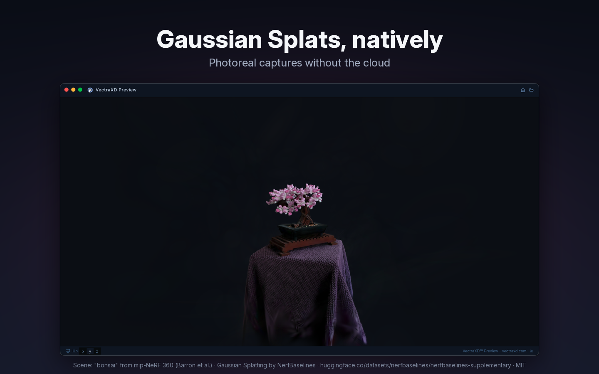
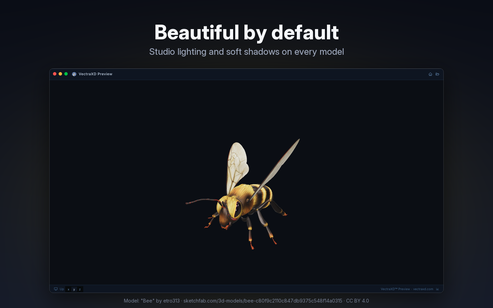
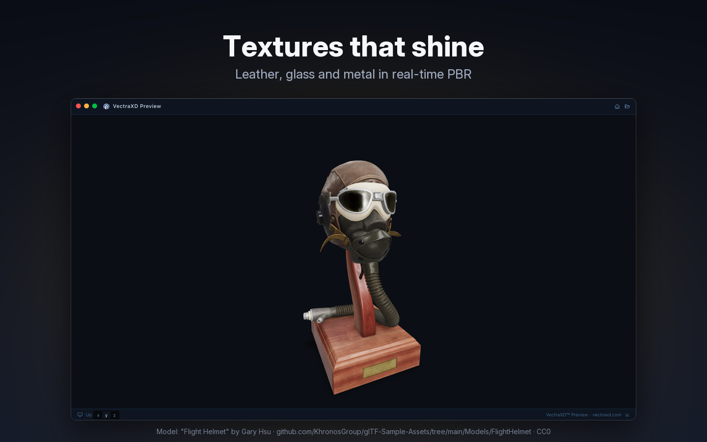
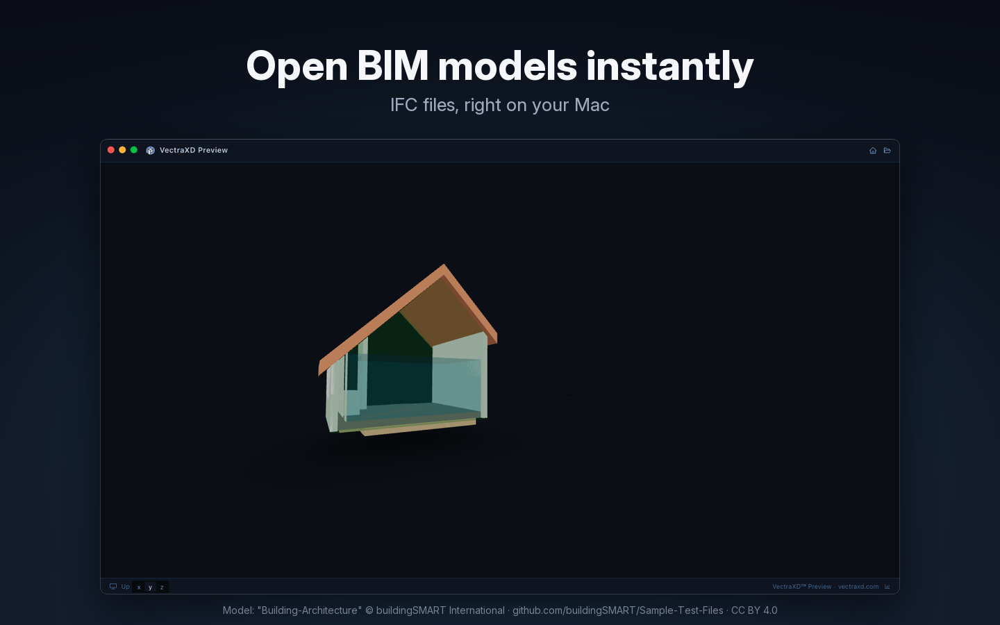
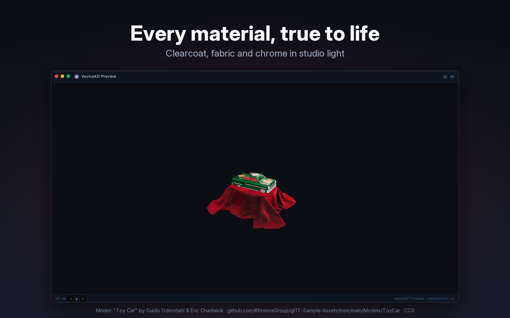
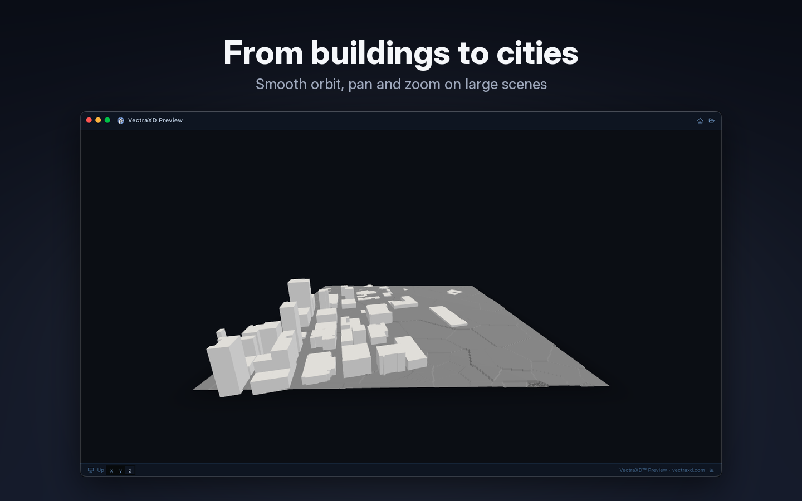
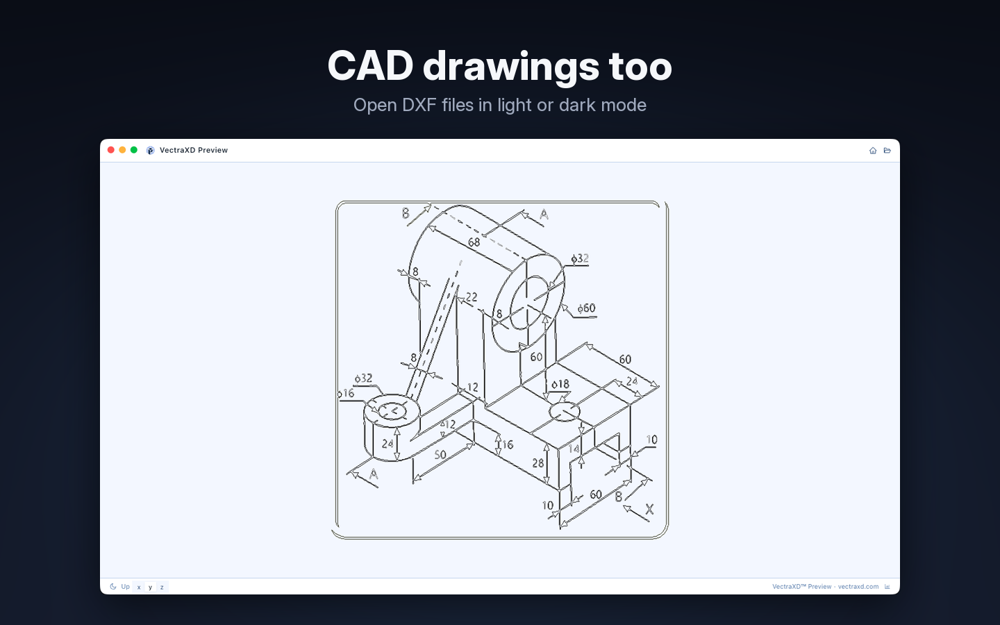
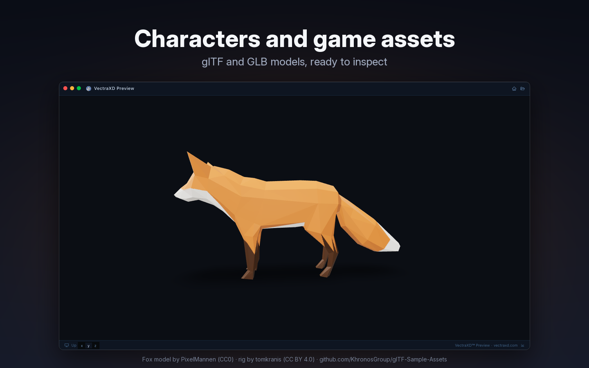
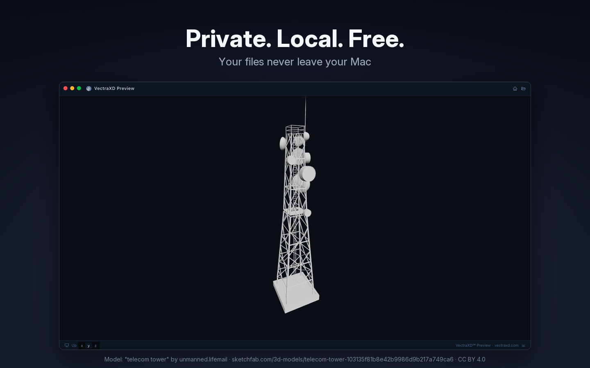

# VectraXD Preview

**Free desktop 3D file viewer for macOS, Windows, and Linux.**

Open GLB, GLTF, OBJ, PLY, IFC, DXF, and Gaussian Splat files instantly — no account required, no cloud upload.



<!-- Mac App Store: uncomment once the app is live and replace <APP_ID>.
<a href="https://apps.apple.com/app/id<APP_ID>"></a>
-->

---

## Screenshots

<table>
  <tr>
    <td></td>
    <td></td>
  </tr>
  <tr>
    <td></td>
    <td></td>
  </tr>
  <tr>
    <td></td>
    <td></td>
  </tr>
  <tr>
    <td></td>
    <td></td>
  </tr>
</table>

Models shown are credited in [CREDITS.md](CREDITS.md).

---

## Download & Install

Get the latest version from the [Releases page](https://github.com/VectraXD/vectraxd-releases/releases/latest). In the file names below, `x.x.x` is the version number.

### macOS

| Mac | File |
|---|---|
| Apple Silicon (M-series) | `VectraXD-Preview-x.x.x-arm64.dmg` |
| Intel | `VectraXD-Preview-x.x.x.dmg` |

Open the `.dmg` and drag **VectraXD Preview** to your Applications folder. The app is signed and notarized by Apple, so it opens normally on first launch.

### Windows

Run `VectraXD-Preview-Setup-x.x.x.exe`. Choose your install directory when prompted. Desktop and Start Menu shortcuts are created automatically.

### Linux

```bash
chmod +x VectraXD-Preview-x.x.x.AppImage
./VectraXD-Preview-x.x.x.AppImage
```

---

## Supported File Formats

| Extension | Format |
|---|---|
| `.glb` `.gltf` | GL Transmission Format — 3D scenes and models |
| `.obj` | Wavefront OBJ — 3D mesh |
| `.ply` | PLY — point cloud / mesh |
| `.ifc` | IFC — BIM / architectural models |
| `.dxf` | DXF — CAD drawings |
| `.splat` | Gaussian Splat — radiance field capture |

---

## Try It with Sample Models

No 3D files at hand? Download one from [`samples/`](samples/) and open it:

| File | Format |
|---|---|
| [`Building-Architecture.ifc`](samples/ifc/Building-Architecture.ifc) | IFC (BIM) |
| [`Building-Hvac.ifc`](samples/ifc/Building-Hvac.ifc) | IFC (BIM, HVAC) |
| [`ToyCar.glb`](samples/gltf/ToyCar.glb) | GLB |
| [`Fox.glb`](samples/gltf/Fox.glb) | GLB |

Larger models are in the sample pack: [download `vectraxd-sample-models.zip`](https://github.com/VectraXD/vectraxd-releases/releases/download/v3.6.0/vectraxd-sample-models.zip) (79 MB). See [samples/README.md](samples/README.md) for details and licenses.

---

## Opening Files

Three ways to open a file:

**Drag and drop** — drag any supported file onto the app window. On the welcome screen, the drop area highlights to confirm it's ready.

**Open dialog** — click **Open File…** on the welcome screen, click the folder icon in the top-right toolbar, or choose **File → Open File…** in the menu bar.

**File association** — VectraXD Preview registers itself for all supported extensions, so it appears under **Open With** in Finder / File Explorer. To make it the default: on macOS, select a file → **Get Info** → **Open with** → **VectraXD Preview** → **Change All…**; on Windows, right-click a file → **Open with** → **Choose another app** → **Always**.

---

## Recent Files

The welcome screen shows your last 10 opened files with relative timestamps. Click any entry to reopen it immediately.

To remove the history, click **Clear** next to the Recent heading.

If a file was moved, renamed or deleted, the app shows a notification instead of opening it.

---

## Theme

Click the theme icon at the bottom-left of the window to cycle through **Light → Dark → System** (follows your OS setting), or use **View → Toggle Theme** in the menu bar.

The preference is saved and restored on next launch.

---

## Up Axis

Models from different tools use different "up" directions. If a model lies on its side, switch the up axis with the **x / y / z** buttons at the bottom-left of the window.

---

## Updates

VectraXD Preview checks for updates automatically in the background. When a new version is available:

1. A notification appears and the update downloads automatically.
2. Click **Install Update** — the app restarts and applies the update.

---

## System Requirements

| Platform | Minimum |
|---|---|
| macOS | macOS 11 Big Sur or later (Apple Silicon or Intel) |
| Windows | Windows 10 (x64) or later |
| Linux | x64; Ubuntu 18.04, Debian 10, Fedora 32 or newer |

A dedicated GPU improves rendering performance for large or complex models, but is not required.

---

## Telemetry & Privacy

Your 3D files are opened and rendered entirely on your computer. They are never uploaded.

VectraXD Preview collects usage analytics to help improve the product:

**What is collected:**
- App launch events (app version, operating system)
- Files opened: format (e.g. "glb") and file size
- File closed events
- Approximate location (country or city), estimated from your IP address

**What is never collected:**
- File contents, file names or file paths
- Personal information such as your name or email

Version 3.6.0 and earlier also sent the name of each opened file. Later versions no longer do.

**Opt out:** click the bar-chart icon at the bottom-right of the window at any time. The setting is stored locally and persists across restarts.

On first launch the app needs an internet connection to register an anonymous device ID, which the rendering engine uses.

Full details: [Privacy Policy](PRIVACY.md).

---

## Troubleshooting

**File opens but nothing renders**
- Check the file is not corrupted by opening it in another tool.
- For `.ifc` files, very large models (100 MB+) may take several seconds to parse.

**Model appears sideways or upside down**
Switch the up axis (**x / y / z**) at the bottom-left of the window.

**App reports a viewer error on launch**
The app needs a network connection on first run to register the device. Make sure internet access is available, then relaunch.

---

## Feedback & Issues

Report bugs or request features on the [Issues page](https://github.com/VectraXD/vectraxd-releases/issues).

---

## Credits & Licenses

VectraXD Preview is free to download and use. It is proprietary software. See [LICENSE](LICENSE) for terms.

Third-party 3D models used in screenshots and sample files keep their original licenses, listed with their authors in [CREDITS.md](CREDITS.md).

---

Copyright © 2020–2026 Prolincur Technologies LLP. All rights reserved.
